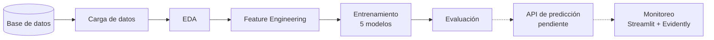

# 📊 Credit Scoring MLOps Pipeline

> **Pipeline de Machine Learning con enfoque MLOps para predecir si un nuevo cliente pagará su crédito a tiempo, desde la carga de datos hasta el monitoreo del modelo.**

<br>

<p align="center">

👥 **Dataset:** 10.763 créditos &nbsp;&nbsp;&nbsp;|&nbsp;&nbsp;&nbsp;
🎯 **Problema:** Clasificación binaria &nbsp;&nbsp;&nbsp;|&nbsp;&nbsp;&nbsp;
🤖 **Modelos comparados:** 5 &nbsp;&nbsp;&nbsp;|&nbsp;&nbsp;&nbsp;
📡 **Monitoreo:** Streamlit + Evidently

</p>

<p>


</p>

---

# 📑 Tabla de contenidos

- [Descripción del proyecto](#-descripción-del-proyecto)
- [Objetivo](#-objetivo)
- [Dataset](#-dataset)
- [Estructura del repositorio](#-estructura-del-repositorio)
- [Cómo ejecutar](#-cómo-ejecutar)
- [Arquitectura del pipeline](#-arquitectura-del-pipeline)
- [Componentes](#-componentes)
- [Principales hallazgos del EDA](#-principales-hallazgos-del-eda)
- [Estado del proyecto y próximos pasos](#-estado-del-proyecto-y-próximos-pasos)
- [Competencias demostradas](#-competencias-demostradas)
- [Autora](#-autora)

---

# 📌 Descripción del proyecto

Las instituciones financieras necesitan evaluar el riesgo asociado a nuevos clientes para optimizar la concesión de créditos y reducir pérdidas.

Este proyecto desarrolla un pipeline de Machine Learning siguiendo principios de **MLOps**: el código está separado en módulos reutilizables para cada etapa del ciclo de vida del modelo (carga de datos, ingeniería de variables, entrenamiento, evaluación y monitoreo).

Más allá del entrenamiento del modelo, el objetivo es demostrar cómo organizar un proyecto de Ciencia de Datos con una arquitectura preparada para evolucionar hacia un entorno productivo.

---

# 🎯 Objetivo

Construir un flujo reproducible que permita:

- Cargar y explorar datos financieros.
- Preparar las variables para el modelado.
- Entrenar y comparar modelos de clasificación.
- Seleccionar el mejor modelo.
- Monitorear las predicciones y detectar data drift.

---

# 📂 Dataset

- 10.763 créditos otorgados, con 23 variables.
- **Variable objetivo:** `Pago_atiempo` (1 = el cliente pagó a tiempo).
- Variables del crédito (`capital_prestado`, `plazo_meses`, `cuota_pactada`, `tipo_credito`), del cliente (`edad_cliente`, `salario_cliente`, `tipo_laboral`, `tendencia_ingresos`) y de su historial crediticio (`puntaje_datacredito`, `cant_creditosvigentes`, `saldo_mora`, entre otras).

> 🔒 El archivo `Base_de_datos.xlsx` no se incluye en el repositorio. Para ejecutar el proyecto, colocarlo en la carpeta raíz.

---

# 🗂 Estructura del repositorio

```
Credit-Scoring-mlops/
├── notebooks/
│   ├── comprension_eda.ipynb             # Análisis exploratorio de datos
│   └── model_training_evaluation.ipynb   # Entrenamiento y comparación de modelos
├── src/
│   ├── carga_datos.py                    # Carga del dataset
│   ├── ft_engineering.py                 # Preprocesamiento de variables
│   ├── model_training.py                 # Entrenamiento, validación cruzada y curvas de aprendizaje
│   ├── model_evaluation.py               # Evaluación del modelo XGBoost (en desarrollo)
│   └── model_monitoring.py               # Dashboard de monitoreo con Streamlit + Evidently
├── requirements.txt
├── .gitignore
└── README.md
```

---

# 🧪 Cómo ejecutar

```bash
git clone https://github.com/VaninaCavallin/Credit-Scoring-mlops.git
cd Credit-Scoring-mlops
pip install -r requirements.txt
jupyter notebook
```

1. Copiar `Base_de_datos.xlsx` en la carpeta raíz del proyecto.
2. Ejecutar `notebooks/comprension_eda.ipynb` (EDA).
3. Ejecutar `notebooks/model_training_evaluation.ipynb` (entrenamiento y comparación de modelos).

Los notebooks importan los módulos de `src/` desde su primera celda.

---

# 🧱 Arquitectura del pipeline



---

# 🔧 Componentes

| Archivo | Descripción |
|---|---|
| `src/carga_datos.py` | Carga el dataset desde `Base_de_datos.xlsx`. |
| `src/ft_engineering.py` | Define las variables numéricas, categóricas y ordinales, y construye un `ColumnTransformer` con imputación y codificación (OneHot y Ordinal). |
| `src/model_training.py` | Entrena un modelo, calcula Accuracy, Precision, Recall y F1 en train y test, aplica validación cruzada (10 folds) y grafica curvas de aprendizaje. |
| `src/model_evaluation.py` | Evaluación del modelo XGBoost guardado. **En desarrollo.** |
| `src/model_monitoring.py` | Dashboard en Streamlit que registra predicciones, compara datos actuales con los de referencia y genera reportes de data drift con Evidently. |
| `notebooks/comprension_eda.ipynb` | Revisión de nulos, tipos de variables, calidad de datos y análisis univariado y bivariado. |
| `notebooks/model_training_evaluation.ipynb` | Entrena y compara Logistic Regression, Linear SVC, Decision Tree, Random Forest y XGBoost. |

---

# 🔍 Principales hallazgos del EDA

- **El tipo de crédito es determinante:** los tipos 4 y 9 tienen un 4.7% de incumplimiento, mientras que el tipo 6 llega al 42.9%.
- **Los independientes tienen más riesgo que los empleados** en todos los tipos de crédito (por ejemplo, 5.71% vs 4.14% en el tipo 4).
- **La tendencia de ingresos importa:** los clientes con ingresos crecientes son los que mejor pagan.
- **Montos altos con salarios bajos** concentran los casos de incumplimiento.
- **Calidad de datos:** `tendencia_ingresos` tenía valores numéricos erróneos (menos del 1%), que se reemplazaron por valores faltantes.

---

# 🚧 Estado del proyecto y próximos pasos

**Implementado**
- ✅ Carga de datos y EDA.
- ✅ Preprocesamiento modular con `ColumnTransformer`.
- ✅ Entrenamiento y comparación de 5 modelos con validación cruzada.
- ✅ Dashboard de monitoreo y data drift.

**Pendiente**
- ⏳ Guardar el modelo entrenado (`xgb_model.json`) para que lo use `model_evaluation.py`.
- ⏳ Completar `model_evaluation.py` para calcular las métricas sobre el conjunto de prueba.
- ⏳ API de predicción con FastAPI (`/predict_batch`), que necesita el monitoreo para funcionar.
- ⏳ Contenerizar la API con Docker.
- ⏳ Configurar la ruta del dataset de referencia en `model_monitoring.py`.

---

# 💼 Competencias demostradas

- Machine Learning y clasificación supervisada
- Análisis exploratorio y control de calidad de datos
- Ingeniería de variables con pipelines de scikit-learn
- Evaluación y comparación de modelos con validación cruzada
- Organización modular de proyectos
- Monitoreo de modelos y detección de data drift
- Versionado con Git y GitHub (ramas `developer` y `certification`)

---

# 👩‍💻 Autora

**Vanina Cavallin**

Doctora en Ciencias Biológicas | Data Scientist | Data Analyst

💼 **LinkedIn:** https://linkedin.com/in/vanina-cavallin
