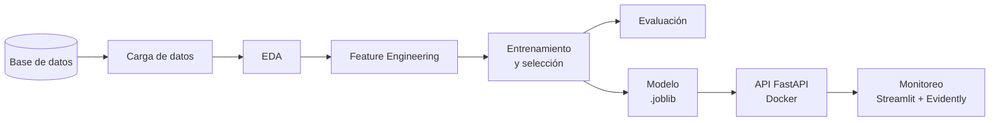
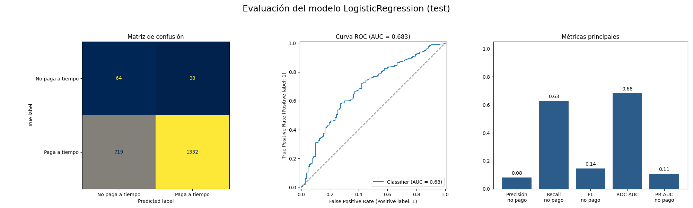

# 📊 Credit Scoring MLOps Pipeline

> **Pipeline de Machine Learning con enfoque MLOps para predecir si un nuevo cliente pagará su crédito a tiempo: desde la carga de datos hasta una API de predicción contenerizada y un dashboard de monitoreo.**

<br>

<p align="center">

👥 **Dataset:** 10.763 créditos &nbsp;&nbsp;&nbsp;|&nbsp;&nbsp;&nbsp;
🎯 **Problema:** Clasificación binaria &nbsp;&nbsp;&nbsp;|&nbsp;&nbsp;&nbsp;
📊 **ROC-AUC:** 0.68 &nbsp;&nbsp;&nbsp;|&nbsp;&nbsp;&nbsp;
🚀 **API:** FastAPI + Docker &nbsp;&nbsp;&nbsp;|&nbsp;&nbsp;&nbsp;
📡 **Monitoreo:** Streamlit + Evidently

</p>

<p>


</p>

---

# 📑 Tabla de contenidos

- [Descripción del proyecto](#-descripción-del-proyecto)
- [Dataset](#-dataset)
- [Estructura del repositorio](#-estructura-del-repositorio)
- [Cómo ejecutar](#-cómo-ejecutar)
- [Arquitectura del pipeline](#-arquitectura-del-pipeline)
- [Componentes](#-componentes)
- [Hallazgo clave: fuga de información](#-hallazgo-clave-fuga-de-información)
- [Resultados](#-resultados)
- [Principales hallazgos del EDA](#-principales-hallazgos-del-eda)
- [Próximos pasos](#-próximos-pasos)
- [Competencias demostradas](#-competencias-demostradas)
- [Autora](#-autora)

---

# 📌 Descripción del proyecto

Las instituciones financieras necesitan evaluar el riesgo asociado a nuevos clientes para optimizar la concesión de créditos y reducir pérdidas.

Este proyecto desarrolla un pipeline de Machine Learning siguiendo principios de **MLOps**: cada etapa del ciclo de vida del modelo (carga de datos, ingeniería de variables, entrenamiento, evaluación, despliegue y monitoreo) es un módulo reutilizable, y el modelo se sirve mediante una API contenerizada con Docker.

---

# 📂 Dataset

- 10.763 créditos otorgados, con 23 variables.
- **Variable objetivo:** `Pago_atiempo` (1 = el cliente pagó a tiempo). Solo el **4.7%** de los clientes no paga a tiempo, por lo que las clases están muy desbalanceadas.
- Variables del crédito (`capital_prestado`, `plazo_meses`, `cuota_pactada`, `tipo_credito`), del cliente (`edad_cliente`, `salario_cliente`, `tipo_laboral`, `tendencia_ingresos`) y de su historial crediticio (`puntaje_datacredito`, `cant_creditosvigentes`, `saldo_mora`, entre otras).

> 🔒 El archivo `Base_de_datos.xlsx` no se incluye en el repositorio. Para ejecutar el proyecto, colocarlo en la carpeta raíz.

---

# 🗂 Estructura del repositorio

```
Credit-Scoring-mlops/
├── notebooks/
│   ├── comprension_eda.ipynb             # Análisis exploratorio de datos
│   └── model_training_evaluation.ipynb   # Comparación exploratoria de modelos
├── src/
│   ├── carga_datos.py                    # Carga del dataset
│   ├── ft_engineering.py                 # Limpieza, preprocesamiento y división train/test
│   ├── model_training.py                 # Validación cruzada y curvas de aprendizaje
│   ├── train_model.py                    # Entrena los modelos candidatos y guarda el mejor
│   ├── model_evaluation.py               # Métricas y gráficos del modelo guardado
│   ├── model_deploy.py                   # API de predicción con FastAPI
│   └── model_monitoring.py               # Dashboard de monitoreo con Streamlit + Evidently
├── Dockerfile                            # Imagen de la API
├── requirements.txt                      # Dependencias del proyecto completo
├── requirements-api.txt                  # Dependencias mínimas de la API (Docker)
└── README.md
```

Al ejecutar el pipeline se generan `models/` (modelo entrenado y métricas) y `reports/` (gráficos), que no se suben al repositorio.

---

# 🧪 Cómo ejecutar

### 1. Instalación

```bash
git clone https://github.com/VaninaCavallin/Credit-Scoring-mlops.git
cd Credit-Scoring-mlops
pip install -r requirements.txt
```

Copiar `Base_de_datos.xlsx` en la carpeta raíz del proyecto.

### 2. Entrenamiento y evaluación

```bash
cd src
python train_model.py
python model_evaluation.py
```

`train_model.py` compara Logistic Regression, Random Forest y XGBoost, y guarda el mejor (por ROC-AUC) en `models/credit_model.joblib`. `model_evaluation.py` genera `reports/evaluacion_modelo.png`.

### 3. API de predicción

```bash
cd src
uvicorn model_deploy:app --port 8000
```

Documentación interactiva en http://localhost:8000/docs. Endpoints:

| Método | Endpoint | Descripción |
|---|---|---|
| GET | `/health` | Estado de la API y modelo cargado |
| POST | `/predict` | Probabilidad de pago a tiempo de un cliente |
| POST | `/predict_batch` | Probabilidades para un lote de clientes (`{"batch": [...]}`) |

### 4. Docker

Con el modelo ya entrenado (paso 2):

```bash
docker build -t api-creditos .
docker run -d -p 8000:8000 --name api-creditos api-creditos
```

### 5. Monitoreo

Con la API en ejecución:

```bash
cd src
streamlit run model_monitoring.py
```

El dashboard envía lotes de clientes del conjunto de test a la API, registra las predicciones en `monitoring_log.csv` y compara su distribución con los datos de entrenamiento (data drift).

---

# 🧱 Arquitectura del pipeline



---

# 🔧 Componentes

| Archivo | Descripción |
|---|---|
| `src/carga_datos.py` | Carga el dataset desde `Base_de_datos.xlsx`. |
| `src/ft_engineering.py` | Define las variables, limpia `tendencia_ingresos`, construye el `ColumnTransformer` (imputación, OneHot y Ordinal) y divide train/test de forma estratificada. Lo usan el entrenamiento, la API y el monitoreo, para que todos procesen los datos igual. |
| `src/model_training.py` | Entrena un modelo, aplica validación cruzada y grafica curvas de aprendizaje (usado en el notebook). |
| `src/train_model.py` | Entrena los modelos candidatos con pesos para la clase minoritaria y guarda el mejor pipeline completo (preprocesador + modelo). |
| `src/model_evaluation.py` | Calcula Accuracy, Precision, Recall y F1 de la clase "no paga", ROC-AUC y PR-AUC, y grafica la matriz de confusión y la curva ROC. |
| `src/model_deploy.py` | API con FastAPI y validación de datos de entrada con Pydantic. |
| `src/model_monitoring.py` | Dashboard que registra predicciones, compara datos actuales con los de referencia y genera reportes de data drift con Evidently. |

---

# 🚨 Hallazgo clave: fuga de información

La variable `puntaje` **separa perfectamente** a los clientes que pagan de los que no: todos los que pagaron tienen un puntaje ≥ 63.8 y todos los que no pagaron, ≤ 62.7 (AUC = 1.0 por sí sola).

Un modelo que la use acierta el 100%, pero no sirve en la práctica: ese puntaje se calcula con información del resultado, que no está disponible al momento de otorgar un crédito nuevo (*data leakage*). Por eso se **excluyó del modelo**. La siguiente variable más predictiva, `puntaje_datacredito`, alcanza un AUC de 0.62.

---

# 📈 Resultados

Conjunto de test (20%, estratificado; 102 clientes que no pagan a tiempo):

| Modelo | ROC-AUC | Recall no pago | Precision no pago |
|---|---:|---:|---:|
| **Logistic Regression** | **0.683** | **0.627** | 0.082 |
| XGBoost | 0.677 | 0.363 | 0.107 |
| Random Forest | 0.671 | 0.020 | 0.667 |

<p align="center">
  
</p>

- El modelo seleccionado (Regresión Logística) **detecta el 63% de los clientes que no pagan a tiempo** (64 de 102).
- La contracara es un alto número de falsas alarmas (precisión de 8%): de cada 12 clientes marcados como riesgosos, aproximadamente uno no paga. Con solo un 4.7% de incumplimiento, igualmente es casi el doble de la tasa base.
- Un ROC-AUC de 0.68 indica una capacidad predictiva moderada: las variables disponibles explican solo una parte del riesgo. En la práctica, el modelo sirve para **priorizar revisiones manuales**, no para rechazar créditos automáticamente.

---

# 🔍 Principales hallazgos del EDA

- **El tipo de crédito es determinante:** los tipos 4 y 9 tienen un 4.7% de incumplimiento, mientras que el tipo 6 llega al 42.9%.
- **Los independientes tienen más riesgo que los empleados** en todos los tipos de crédito (por ejemplo, 5.71% vs 4.14% en el tipo 4).
- **La tendencia de ingresos importa:** los clientes con ingresos crecientes son los que mejor pagan.
- **Montos altos con salarios bajos** concentran los casos de incumplimiento.
- **Calidad de datos:** `tendencia_ingresos` tenía valores numéricos erróneos (menos del 1%), que se tratan como valores faltantes.

---

# 🚀 Próximos pasos

- Ajustar el umbral de decisión según el costo de negocio de un falso negativo frente a un falso positivo.
- Incorporar nuevas variables (historial de pagos, comportamiento transaccional) para mejorar el poder predictivo.
- Registrar experimentos y versiones del modelo con MLflow.
- Automatizar el entrenamiento y el despliegue con CI/CD.

---

# 💼 Competencias demostradas

- Machine Learning y clasificación con clases desbalanceadas
- Detección de fuga de información (*data leakage*)
- Ingeniería de variables con pipelines de scikit-learn
- Evaluación y selección de modelos
- Despliegue de modelos con FastAPI y Docker
- Monitoreo de modelos y detección de data drift
- Organización modular de proyectos y buenas prácticas de MLOps
- Versionado con Git y GitHub

---

# 👩‍💻 Autora

**Vanina Cavallin**

Doctora en Ciencias Biológicas | Data Scientist | Data Analyst

💼 **LinkedIn:** https://linkedin.com/in/vanina-cavallin
